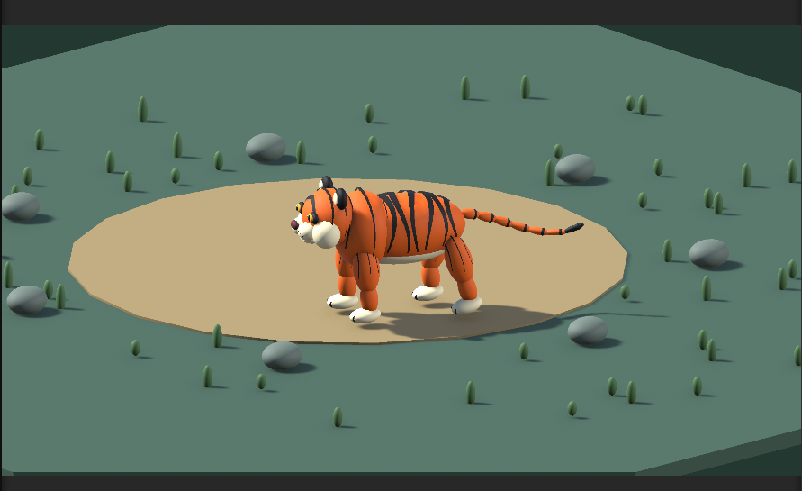

# unity_tiger
anime by VibeCoding.

「CatGTP Desktop」をインストール
新しいチャットで

１．「UnityのMCP入れてプロジェクト作って」で環境構築

   > 勝手にインストールと設定を始める

２．「CatGTP Desktop」を再起動

３．Unityを起動して「3Dの寅を作って歩かせて」という

   > サクッと作ってくれたのがこのファイル

※Unityプロジェクトの作りがよく分かってない
　調べたところパブリックではあげない方が良いと言う意見が多かったので、、、
 
